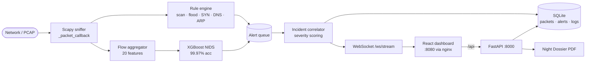

# ◈ PLEXUS v3.0 (NIDS Integrated — Security Hardened)

[](https://fastapi.tiangolo.com)
[](https://react.dev)
[](https://xgboost.readthedocs.io)
[](https://scapy.net)
[](https://sqlite.org)
[](https://huggingface.co/convaiinnovations/laya-typed-decisions)
[](https://github.com/Rishabh4769/Project-Plexus/actions/workflows/ci.yml)
[](https://www.python.org/downloads/)
[](LICENSE)

PLEXUS v3.0 is a state-of-the-art **Network Intrusion Detection System (NIDS)** and traffic monitoring suite. Combining real-time Scapy packet capturing, bidirectional network flow aggregation, and a tuned **XGBoost machine learning classifier** trained on the *CICIDS2017* benchmark dataset, PLEXUS delivers live threat detection and native desktop alerts. See [VERSION.md](VERSION.md) for the v3.0.0 security-hardening changelog and [flow.md](flow.md) for the detection-pipeline workflows.

---

## Key Features

* **Real-time Capture & Decoupled Sniffer:** Multithreaded Scapy engine extracting src/dst IPs, ports, TTL, checksums, and hex payload previews.
* **Rule-based Detection (fast path):** Port-scan and flood heuristics evaluated per-packet in the capture callback — alerts surface in ~0.5 s. Tunable thresholds (flood default: 1500 packets / 10 s window).
* **ML-based NIDS Engine:** Tuned XGBoost classifier trained on Monday (Benign), Tuesday (SSH/FTP attacks), and Friday (PortScan) datasets, hitting **99.97% accuracy** and a **0.995 F1-score**.
* **Laya Second Opinion (beta):** `convaiinnovations/laya-typed-decisions` (ModernBERT-large) re-scores XGBoost-flagged flows with an attack probability + category note. Never replaces XGBoost; disable with `PLEXUS_DISABLE_LAYA=1`.
* **Severity-coded Traffic Graph:** Alert dots appear only where alerts exist — yellow for normal (port scans), red for critical (floods, ML anomalies).
* **Flow Aggregation:** Automatically groups raw packet packets into bidirectional network conversation flows and calculates 20 distinct statistical features in real-time.
* **Native OS Desktop Alerts:** Zero-dependency native macOS slide-in notifications (using `osascript` AppleScript with audio alert cues) and Linux `notify-send` alerts.
* **PCAP Offline Analysis:** Batch upload `.pcap` or `.pcapng` files to reconstruct and analyze network sessions for threats.
* **Interactive Dashboard:** Beautiful React-based interface featuring real-time packet visualisers, chart telemetry, and historical session logs.
* **Report Generation:** Automatic PDF summary reports of captures and alerts using ReportLab.
* **Extended Detection Rules:** SYN-flood detection (500+ bare SYNs / 10 s window), DNS-tunneling heuristic (overlong / high-entropy query names), and ARP-spoofing detection (IP→MAC change tracking) — all evaluated per-packet alongside port-scan and flood rules.
* **Incident Correlation:** Alerts from the same source IP roll up into incidents with severity scoring (critical / high / medium / low) — SOC-analyst-style triage instead of alert noise.
* **Threat-Intel Enrichment:** Source IPs are checked against a local blocklist (`backend/data/blocklist.txt`); hits are tagged `[blocklisted]` on the alert.
* **Tested & CI-gated:** 89 pytest tests (auth, database, rate limiting, detection boundaries, PDF reports, Docker/CORS config) run on every push via GitHub Actions — no root or network required.
* **One-Command Deploy:** `docker compose up --build` runs the full stack (FastAPI + nginx-served React UI) with live-capture capabilities granted to the container.

---

## Architecture



---

## Directory Architecture

```
Project-Plexus/
├── backend/
│   ├── auth.py             # Auth & user session management
│   ├── database.py         # SQLite parameterized queries layer (PLEXUS_DB_PATH-overridable)
│   ├── incidents.py        # Alert→incident correlation + severity scoring
│   ├── threatintel.py      # Local blocklist enrichment (backend/data/blocklist.txt)
│   ├── main.py             # FastAPI entrypoint, routes, & WebSocket broadcaster
│   ├── notifications.py    # Zero-dependency OS desktop notifications
│   ├── report.py           # PDF report builder (ReportLab)
│   ├── sniffer.py          # Multithreaded packet capture (Scapy) + rule engine
│   ├── Dockerfile          # Backend image (python:3.12-slim, non-root)
│   └── requirements.txt    # Production dependencies
├── frontend/
│   ├── src/
│   │   ├── components/     # App views (Dashboard, Alerts, Packet Table, Charts)
│   │   ├── hooks/          # API & WebSocket managers (single-socket, alert dedup)
│   │   └── App.jsx
│   ├── nginx.conf          # Reverse proxy: /api/* and /ws/* → backend
│   ├── Dockerfile          # Multi-stage: node build → nginx serve
│   ├── package.json
│   └── index.html
├── tests/                  # 89 pytest tests (no root/network needed)
├── .github/workflows/ci.yml  # CI: backend tests + frontend build on push/PR
├── docker-compose.yml      # One-command deploy (backend + frontend)
├── ml/
│   ├── artifacts/          # Serialized models, scalers, feature specs, & metrics
│   │   ├── model.joblib    # Trained XGBoost model
│   │   ├── scaler.joblib   # Trained StandardScaler
│   │   └── feature_spec.json
│   ├── inference/
│   │   └── laya_scorer.py  # Laya second-opinion scorer (beta)
│   ├── data_cleaning/      # Data cleaning pipelines & validation checks
│   │   ├── clean_data.py
│   │   └── validate_data.py
│   └── train/              # Offline classifier training scripts
│       ├── export_features.py
│       └── train_xgboost.py
├── flow.md                 # Detection workflows, data-flow & latency notes
├── VERSION.md              # Version history, bugs & fixes
├── PLEXUS.sh               # Root orchestration launch script (Backend + Frontend)
└── README.md
```

---

## Screenshots

> 📸 Coming soon — dashboard, live alerts view, and a Night Dossier report sample.

---

## Documentation

* **[flow.md](flow.md)** — Detection workflows: rule-based vs ML paths, broadcast pipeline, alert-severity colour mapping, and measured latency.
* **[VERSION.md](VERSION.md)** — Version history with bugs, fixes, and known issues.
* **[MD/PRD.md](MD/PRD.md)** — Product requirements document.
* **[MD/Structure.md](MD/Structure.md)** — Codebase structure reference.

---

## System Requirements

* **OS:** macOS (fully integrated) or Linux (Ubuntu/Debian)
* **Python:** 3.10+
* **Node.js:** 18+
* **Admin privileges:** `sudo` access is required to capture network interfaces.

---

## Setup & Running

Simply run the unified orchestration script from the project root:

```bash
sudo ./PLEXUS.sh
```

The script will automatically:
1. Initialize a Python virtual environment (`.venv`) and install backend dependencies.
2. Install React frontend packages via npm.
3. Start the FastAPI backend server on `http://127.0.0.1:8000` (prompting for sudo to capture interfaces).
4. Run the React Vite development server on `http://localhost:5173` and open your browser.

To stop both servers cleanly, press `Ctrl+C` in your terminal.

### Docker (one-command deploy)

```bash
docker compose up --build
# then open http://localhost:8080
```

This builds the FastAPI backend (with `NET_RAW`/`NET_ADMIN` capabilities so live
packet capture works inside the container) and serves the React frontend through
nginx, which reverse-proxies `/api/*` and `/ws/*` to the backend. The SQLite
database persists in a Docker volume. CORS origins are configurable via the
`PLEXUS_CORS_ORIGINS` environment variable.

---

## Training the ML Pipeline

If you want to clean raw CICIDS2017 datasets and retrain the XGBoost classifier yourself, use the following execution steps:

```bash
# 1. Clean the raw CSV datasets (Monday, Tuesday, Friday PortScan)
.venv/bin/python3 ml/data_cleaning/clean_data.py

# 2. Run data validation gate
.venv/bin/python3 ml/data_cleaning/validate_data.py

# 3. Export top 20 ranked features spec
.venv/bin/python3 ml/train/export_features.py

# 4. Train the classifier and scale model parameters
.venv/bin/python3 ml/train/train_xgboost.py
```

---

## API Reference

Interactive OpenAPI documentation is hosted at `http://127.0.0.1:8000/api/docs` while the backend is active.

### Key Routes

| Method | Endpoint | Description |
|--------|----------|-------------|
| `POST` | `/api/capture/start` | Start live packet sniffing |
| `POST` | `/api/capture/stop` | Stop live sniffing |
| `POST` | `/api/capture/analyze-pcap` | Upload and analyze a PCAP file |
| `POST` | `/api/capture/settings` | Adjust live detection parameters |
| `GET`  | `/api/sessions/{id}/report` | Generate PDF report |
| `WS`   | `/ws/stream` | Websocket raw logs/alerts stream |

---

## Troubleshooting

### Login fails / locked out of your account

User accounts are stored in the `users` table inside `network_traffic.db` (project root). If you cannot log in and cannot recover the credentials, reset the login database:

1. Stop the backend (`Ctrl+C` in its terminal).
2. Delete the database file:
   ```bash
   rm network_traffic.db
   ```
3. Restart with `sudo ./PLEXUS.sh`.
4. With no users left in the database, PLEXUS returns to its first-run state — use the initial-setup screen to create a new admin user.

> Note: deleting `network_traffic.db` also wipes captured packets, alerts, and session history. Back it up first if that history matters.

---

## Security Notes

* **No remote exposure:** Backend binds strictly to loopback (`127.0.0.1`).
* **SQL Injection protection:** Database calls use SQLite parameter bindings exclusively.
* **BPF Whitelist validation:** Packet capture filter inputs are validated against a whitelisted regex.
